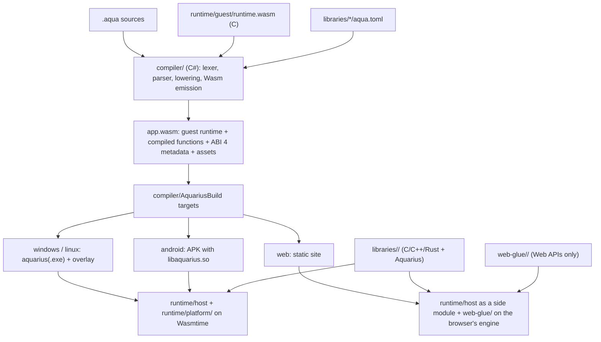

# Architecture

AquariusLang is a bilingual Traditional Chinese / English compiled language. Chinese and English keywords map to the
same tokens and AST, so a file may mix both; see the [language reference](compiler/AquariusCompiler/LANGUAGE.md).

C# is only the compiler. Every target runs the compiled `.wasm` application on one native runtime written in C:
Wasmtime's C API on desktop and mobile, the browser's WebAssembly engine on the web. Libraries are AquariusLang, C, C++
or Rust; JavaScript exists only in `web-glue/`, and only to expose Web APIs. The rules that keep it this way are in
[CLAUDE.md](CLAUDE.md); read them before changing anything.



## Repository layout

```text
compiler/            C#, compile time only
  AquariusCompiler     front end, IR, Wasm emission, application packaging, library manifests, installation lookup
  AquariusBuild        build targets (windows, linux, web, android) from runtime packs
  AquariusBottle       TOML projects, dependencies, locks
  AquariusCli          the aqua command (build, run, REPL, export)
  AquariusLanguageServer, AquariusTests
runtime/             C, the run time of every target
  guest/               runtime.c: values, GC, scheduler, linked into every application (layout.def is the shared table)
  host/                the host core: metadata, imports, registry, calls, scheduler, threads, the core library
  platform/<os>/       windows, linux, posix, desktop (Windows + Linux), android (+ the Java activity shim), web
  sdk/                 aqua/*.h, api.def, AquariusLibrary.cmake, toolchain files, an example library
libraries/<name>/    default libraries, one self-contained folder each
web-glue/            the only JavaScript: core/ (loader, WASI, start), page/, one folder per Web API domain
scripts/             toolchain pins and installers, runtime builds, library tests, web/Android runners, release
examples/, tests/, docs/, editors/, website/
```

## Compiler

The front end lowers syntax to a compiler-only IR and emits standard WebAssembly; no instruction stream, AST
interpreter or opcode dispatcher is deployed. `WasmCompiler` links the guest runtime (`runtime/guest/runtime.wasm`,
embedded in the compiler) with the compiled functions. Struct offsets come from `runtime/guest/layout.def`, the one
table both C and C# read (`RuntimeLayout`, `runtime/guest/layout.h`).

Each compiled function exports `aqua_fN(i32 frame) -> i32`. Frames and continuations live in Wasm memory; basic blocks
are structured branches and `br_table`. A nonnegative result is a continuation, -1 completes the function. Generic
calls and member resolution suspend at compiler-generated boundaries, so Aquarius recursion never uses a host call
stack, and the web host can wait for Web APIs between turns. Eligible closed scalar functions use a typed calling
convention ([portable numeric compilation](docs/portable-numeric-architecture.md)); generic functions keep frames in
slots and locals ([execution tiers](docs/execution-tiers.md)).

An application is one `.wasm` with an `aquarius.application` custom section (ABI 4 binary metadata: layout, function
count, script modules, entry, platforms, assets, the import table of bundled library modules and the native libraries
it needs) and, when assets are embedded, a raw `aquarius.assets` section. See the
[compiler README](compiler/AquariusCompiler/README.md#application-metadata-abi-4). Compilation never runs code.

## Guest runtime

`runtime/guest/runtime.c` is freestanding C compiled to Wasm with the pinned Clang. Dynamic values, lexical scopes,
arrays, hashes, strings (UTF-16), closures, the script scheduler and the garbage collector run inside the application.
The portable modules (Array, Hash, String, Thread) are part of it. The guest reaches the host only through the
`aquarius_v2.service` import (`runtime/host/calls.c` handles it): capability lookup, native calls and object access.
Native handles are traced from guest roots and stamped with the collection generation; the heap may grow to 2 GiB
because library data (pixel arrays, images, tensors) lives in guest memory.

## Host core and platform layers

`runtime/host` is one C code base for every target. `engine_wasmtime.c` and `engine_web.c` are the only engine-specific
files: the first drives Wasmtime on Windows, Linux and Android, the second runs inside the browser as a position
independent side module sharing the application's memory. The host reads the metadata (`application.c`), registers
the default libraries compiled into this runtime build and the external ones named with `--library` or by the
application (`registry.c`, `session.c`), runs the guest's scheduler and native ticks (`scheduler.c`), and runs Thread
workers as separate instances (`threads.c`, `threads_web.c`).

Everything that differs per OS is a thin layer in `runtime/platform/<os>/`: process entry, files, clocks, dynamic
loading and the window/input implementation of `<aqua/window.h>` (GLFW on desktop, `ANativeWindow` on Android, a
`<canvas>` on the web). Android's Java is only `AquariusActivity`, a `NativeActivity` subclass forwarding what Android
delivers to Java alone. A new target is a toolchain file, a platform layer, pins and a build target.

## Libraries

A library is `libraries/<name>/` (or an external Bottle package of the same shape): `aqua.toml` (manifest version 2:
`[library]`, `[native] modules`, `[[modules]]` Aquarius sources, `[android] permissions`), `CMakeLists.txt` with
`aqua_add_library`, `src/`, `aqua/`, pinned third-party code, `tests/` and a README. The same source builds for every
target: on native targets default libraries link into the runtime and external ones become `aqua_<name>.dll` /
`libaqua_<name>.so`; on the web each becomes a side module `<name>.wasm`. Modules register through `AQUA_LIBRARY` and
call the runtime only through the function table of `<aqua/aqua.h>` (`api.def`). See the
[library SDK](runtime/sdk/README.md) and [external libraries](docs/external-libraries.md).

| Library | Modules |
| --- | --- |
| [application](libraries/application/README.md) | Application, Files, Paths, Images, Serialization, Storage, Clipboard, Tasks, TextEdit |
| [audio](libraries/audio/README.md) | Audio (miniaudio) |
| [camera](libraries/camera/README.md) | Webcam, Camera |
| [graphics](libraries/graphics/README.md) | Processing, WGPU, GLM, TextInput, Window, Fonts, Models, PBR, GPUMath (webgpu.h on wgpu-native or the browser) |
| [input](libraries/input/README.md) | AndroidInput |
| [network](libraries/network/README.md) | Network: HTTP(S), WebSocket, TCP/TLS/UDP, HTTP server (mbedTLS) |
| [onnx](libraries/onnx/README.md) | ONNX, MediaPipe (ONNX Runtime; built from C++ for the web) |
| [opengl](libraries/opengl/README.md) | GLFW, GLAD, GL, STBImage (desktop) |
| [terminal](libraries/terminal/README.md) | Terminal |

## Web glue

`web-glue/core` instantiates `program.wasm`, links the host core, the C/C++ runtime libraries and the needed library
side modules into the application's memory (`dylink.0`), provides WASI and drives the host's loop from the event loop.
Every other folder exposes one Web API (window, webgpu, audio, camera, network, storage, files, clipboard, canvas,
print, accessibility, thread for Web Workers) and registers with `core/glue.mjs`; `index.mjs` imports them once. Glue functions translate
arguments, make one Web API call and hand the result back; all logic stays in C/C++. See the
[web glue README](web-glue/README.md).

## Toolchain

One pinned LLVM Clang (`scripts/toolchain.json`) builds the guest runtime, every web side module, Windows (Clang +
the llvm-mingw sysroot, never MSVC) and Linux; Android uses the pinned NDK's Clang. Wasmtime and wgpu-native come in as
pinned prebuilt C SDKs. `scripts/install-toolchain.ps1` installs them and `scripts/build-runtime.ps1` builds the
runtime packs into `.native-build/install/<target>`, where the compiler of a checkout finds them.

## Tests

- `dotnet test compiler/AquariusTests`: language semantics, Wasm emission, codegen goldens, packaging, build targets,
  CLI, language server and the architecture rules below. Programs run on the runtime pack of this machine.
- `scripts/test-libraries.ps1`: every library's `tests/<case>.aqua` on Windows, Linux (WSL), the web (Chromium) and
  Android (device or emulator); output must equal `<case>.expected`.

### Enforced rules

`compiler/AquariusTests/architecture/ArchitectureRulesTest.cs` checks the rules of [CLAUDE.md](CLAUDE.md) on every
`dotnet test`:

| Rule | Test |
| --- | --- |
| C# only in `compiler/`; compiler projects carry no runtime packages; the solution holds exactly the compiler projects | `CSharpIsOnlyTheCompiler`, `CompilerProjectsCarryNoRuntimePackages`, `TheSolutionHoldsTheCompilerProjects` |
| JavaScript only in `web-glue/`; each glue domain self-contained | `JavaScriptLivesOnlyInWebGlue`, `WebGlueDomainsAreSelfContained` |
| Each library a valid, self-contained folder whose manifest matches what it registers | `EveryLibraryHasAValidManifest`, `LibrariesReachNothingOutsideTheirFolder`, `NativeModulesInManifestsAreTheOnesTheRuntimeRegisters` |
| No code generators; no MSVC | `NoCodeGenerators`, `WindowsBuildsNeverUseMsvc` |
| One layout table, one Wasm encoder, the ABI the runtime reads | `GuestRuntimeChecksTheSharedLayoutTable`, `EmittersUseNamedRuntimeOffsets`, `OneWasmEncoder`, `TheCompilerEmitsTheAbiTheRuntimeReads` |
| One portable artifact for every target; target-specific tuning only in engine and platform layers | `EveryTargetRunsOnePortableArtifact` |
| Reviewed codegen changes; the embedded guest runtime rebuilds from source | `CompiledOutputMatchesGoldens`, `TheEmbeddedGuestRuntimeRebuildsFromSource` |
| Repository hygiene | `NoCommittedIdeOrUserFiles`, `AquariusSourcesLiveInExamplesLibrariesAndTests`, `DocsUseRepositoryRelativeLinks` |

After an intended codegen change, run `AQUARIUS_UPDATE_CODEGEN_GOLDENS=1 dotnet test compiler/AquariusTests --filter
CompiledOutputMatchesGoldens` and commit `compiler/AquariusTests/architecture/codegen-goldens.txt`. After changing
`runtime/guest`, rebuild `runtime.wasm` with `scripts/build-wasm-runtime.ps1` and commit it with its source.
