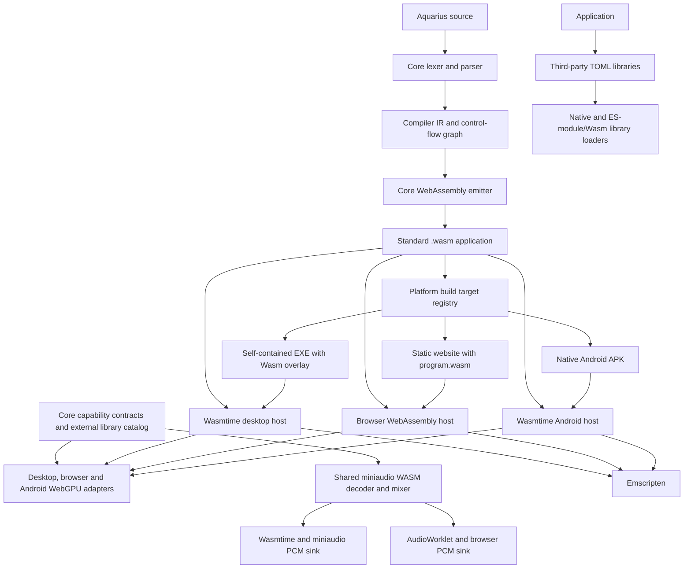

# WebAssembly compiler and cross-platform hosts

AquariusLang is a bilingual Traditional Chinese / English programming language.
Chinese and English keywords map to the same frontend tokens and AST; a file or
module can mix both freely. `else if` and `否則如果` share the same conditional
branch representation. All hosts therefore execute the same Wasm semantics.
See [bilingual syntax and language behavior](AquariusCore/LANGUAGE.md#bilingual-syntax).

Networking contracts, optional platform capabilities, bilingual client/socket APIs and
the desktop HTTP(S) server are documented in [Network / 網路](docs/networking.md).

攝影機的核心抽象、桌面與網頁配接器、生命週期及驗證方式見 [攝影機架構指南](docs/webcam.md)。
ONNX Runtime 的雙語契約、執行提供者目錄與選擇策略、各平台配接器（CUDA、TensorRT、Core ML、WebGPU、WebNN、NNAPI、XNNPACK）、模型封裝及擴充方式見 [推論架構指南](docs/onnx.md)。

The [Thread / 執行緒 library](docs/threading.md) runs snapshot-isolated functions on desktop OS threads, browser Web Workers and Android native Wasmtime workers, with cancellation, joins and portable result graphs.

This document describes the current implementation. The
[remaining Wasm migration work](docs/wasm-architecture-migration.md) tracks moving
language execution and portable libraries into Wasm, removing unnecessary C#/.NET
dependencies, and completing cross-platform deployment. The [implementation status](docs/wasm-migration-progress.md)
distinguishes completed runtime changes from remaining library and toolchain work. Future computational
libraries must follow the [Wasm inclusion requirement](docs/external-libraries.md#requirement-for-future-libraries).

Optional project management lives in [AquariusBottle](AquariusBottle/README.md).
The CLI and language server share its TOML schema, semantic version constraints,
local/GitHub sources, immutable global snapshots, dependency locks and read-only
editor inspection. Project builds stage declared sources and assets into the
existing packaging pipeline, placing libraries under `/bottles/NAME/`. The core
Wasm metadata preserves supported-platform declarations through later deployment.
No dependency resolver, registry client or manifest parser is shipped as part of
the generated program's runtime.

Aquarius is a compiled language. The front end lowers syntax to compiler-only IR,
then emits standard WebAssembly functions and control flow. No Aquarius instruction
stream, AST interpreter or opcode dispatcher is deployed. Dynamic values, lexical
bindings, arrays, hashes, closures, script-call scheduling and garbage collection
execute in the linked freestanding Wasm runtime. The `aquarius_v2.service` import
transports capability lookup, calls and native module access. Hosts project values
only at capability and embedding boundaries. Portable builtins execute in Wasm.

Eligible closed scalar functions also use a private typed Wasm calling convention
with register values and guarded direct recursion. Failed speculation returns to
the resumable implementation before yielding. Lexical ancestor slots are guarded
by capture ownership. See [portable numeric compilation](docs/portable-numeric-architecture.md).
Generic functions keep closure-free scopes in frame slots, keep their operand stack
in Wasm locals, consume fuel only at loop heads and run callees directly on the Wasm
stack up to a bounded depth. See [generic execution tiers](docs/execution-tiers.md).

Each compiled function exports `aqua_fN(i32 frame) -> i32`. The frame and its
continuation live in Wasm memory. Compiled basic blocks use structured Wasm branches
and `br_table`, calling guest runtime helpers directly. A nonnegative result is a
continuation; -1 completes the function. Generic calls and member resolution suspend at
compiler-generated boundaries. The guest scheduler runs compiled function frames without
using the C# or JavaScript call stack for Aquarius recursion. Browser host calls
can await GPU mapping, external-library initialization and animation frames.
Checkpoints bound each browser turn and make cancellation observable in pure loops.
Every execution owns its value frames, including callback reentry. Native handles
are traced from guest roots and recycled; transport leases retain externally held
modules, closures and projected scopes. A host scope passed to an execution becomes a live
view of its guest scope (lookups and assignments go to guest memory), so native calls copy
no bindings in either direction; disposing the runtime leaves it a plain scope with the
final bindings. Array and hash mirrors do not pin their guest
objects: when the guest drops one, its collector reports it on a released list and the
host forgets the mirror, which then stays usable as a detached value. Hosts refresh a
mirror only when the runtime reports it stale (changed since its dirty list was taken),
and read arrays through borrowed views without copy-on-write. Changed host-visible
arrays are copied back before capability access. The guest allocator coalesces
adjacent free blocks and splits larger ones before growing the heap; a collection is
due after net allocation or heap growth reaches a threshold that shrinks with the
remaining headroom under the 512 MiB heap limit.

Hosts trace active language scopes, operands, suspended native arguments and
callback closures at frame boundaries to reclaim unused Processing canvases and
images. Extracted native methods retain their resource scope. Host ownership
registries are not roots, and failed/completed executions release their roots.
Processing's optional `error` event handles input callback failures on both hosts;
`errorEvent` and `errorMessage` describe the failure. Unhandled failures, failures
in the error handler and browser cancellation still terminate execution.

A `.wasm` file contains executable Wasm sections, exactly one `aquarius.application`
custom section and, when the application embeds assets, one raw `aquarius.assets` section.
ABI 3 metadata is binary: memory layout, function count, the module/function mapping,
supported platforms and asset names with lengths (asset bytes follow in `aquarius.assets`,
or live beside the module in web and Android deployments). Executable constants, function
definitions and parameter names are in Wasm data segments, which is where hosts read closure
parameters. Compiled closures inspect as `函式(params) {...}`; no source text is shipped.
Module identities retain their source-relative `.aqua` names. New hosts still load ABI 2
artifacts (JSON metadata with constant pools and base64 assets); ABI 2 hosts cannot load
ABI 3 artifacts, so applications and runtime packs move to ABI 3 together. Application loaders
bound sizes and reject malformed metadata and unsafe paths. Engines independently
validate Wasm types and code. Repeated script imports create independent globals;
registered native modules are shared within a host session. Closures retain their
module environment and builtins for deferred imports.

`AquariusPackaging` depends only on core. It compiles modules and resources directly
into the Wasm application and stages output before replacement. `.bottle` and
`.rius` are retired; old applications must be recompiled from source.
`AquariusCli` can build Wasm, websites and EXEs directly from sources, or export a
previously compiled Wasm application. Compilation and export never execute code.

`AquariusBuild` registers targets through `IWasmBuildTarget`; new platforms do not
change CLI parsing. Windows deployment preserves the self-contained runtime-pack
design and checksummed executable overlay. Overlay version 2 contains Wasm plus
entry metadata; runtime packs declare the Wasm ABI version. The application host
runs the embedded module through Wasmtime. Runtime packs are rebuilt by release
tooling, and generated applications need no installed SDK or .NET runtime.

Core retains `IWgpuBackend`, device/buffer/shader/render-target contracts, validation,
aliases, shader declarations and the 1,120-byte Processing uniform ABI. Desktop
uses Silk.NET and wgpu-native; browsers use WebGPU. Devices own GPU resources and
reject foreign or disposed handles. Window integration remains host-specific.
OpenGL remains available for compatibility with existing examples; future main
graphics implementations use the core WebGPU boundary.

Models and PBR are embedded Aquarius source libraries linked into the application's
Wasm by core. OBJ/MTL parsing, validation, normal generation, ear clipping and
material/mesh assembly execute in compiled Wasm; both adapters consume the same
metallic/roughness WGSL and retained vertex attributes. Files' read-only asset calls
reuse the package resource boundary. See [PBR and model import](docs/pbr-models.md).

Core owns external library descriptors and portable host contracts. Terminal
launches explicit scripts through desktop/Android adapters and reports unsupported
browser execution. Jolt is an independent TOML Bottle package, with its bindings,
engine assets and numerical tests outside core. Generic ES-module factories run
on ClearScript/V8 on desktop, browser JavaScript, and QuickJS-NG on Android; Aquarius
application execution remains in compiled Wasm. OpenCV packages use native C++
matrix handles or portable OpenCV Wasm according to their platform assets. See
[external libraries](docs/external-libraries.md) for extension rules and profiles.

Application contracts and language registration remain in `AquariusCore/application`.
Adapters provide file resources, codecs, clipboard, windows/input, fonts, persistence
and host services. User documents retain opaque provider identities, separate from
bundled assets. Desktop assets are materialized in a private temporary directory
and cleaned up with the runtime; writable output paths remain relative to the
relocated application. Browsers use a virtual filesystem. See the
[application API](docs/application-libraries.md).

Validation includes language semantics through Wasmtime, Wasm round trips and
corruption, deep recursion, async browser calls/cancellation, callback reentry,
desktop/browser execution of identical binaries, generic script-library tests,
source-free imports/assets, CLI and standalone EXE smoke tests, and opt-in desktop
and browser WebGPU regressions. The example scripts and marble-run remain the
compatibility target.

## Enforced architecture rules

These rules are checked by `AquariusTests/architecture/ArchitectureRulesTest.cs` (plain `dotnet test`,
category `Architecture`, a few seconds) and by the `.github/actions/wasm-toolchain` step in every CI job
that builds. A failure names the rule and the legitimate way to change things.

| Rule | Why | Enforced by |
| --- | --- | --- |
| No Zig | One pinned toolchain builds every Wasm/native helper; a second compiler would make binaries irreproducible. Historical validation records may mention Zig. | `NoZigToolchain` |
| Reproducible Wasm binaries | `runtime.wasm`, `audio.wasm` and `pose.wasm` are committed; they must rebuild byte-identically from source with the pinned LLVM/Clang 23.1.3 (`scripts/wasm-toolchain.json`) on Windows, Linux and macOS. | `CommittedWasmBinariesRebuildFromSource` (runs where the toolchain is installed), the `-Check` scripts in CI |
| Generated sources are fresh | Library catalogs, portable library tables (C#, JavaScript and C) and the guest memory layout each have one source table; hand edits drift. Libraries the catalog generator scans have no hand-written catalog entries, and every function registered in code needs a translation. | `GeneratedSourcesAreFresh` (`--check` of each generator), `GeneratedLibrariesHaveNoHandWrittenEntries` |
| Runtime layout | C# emitters and hosts address guest structs only through `RuntimeLayout` constants; `runtime/layout.h` asserts the same offsets in `runtime.c`. | `RuntimeIncludesGeneratedLayoutChecks`, `EmittersUseNamedRuntimeOffsets`, the runtime build |
| One Wasm encoder | LEB128 and instruction immediates are encoded only by `WasmEncoding`. | `OneWasmEncoder` |
| ABI 2 compatibility | New hosts keep loading and running applications built by the ABI 2 compiler. | `Abi2ArtifactsStillLoadAndRun` (committed `AquariusTests/compiler/fixtures/abi2-application.wasm`), `wasm-manifest.test.mjs` |
| Codegen stability | Any emitter or runtime change that alters compiled output for the golden programs is a reviewed, intentional update. | `CompiledOutputMatchesGoldens` |
| Dependency direction | `AquariusCore` references no project and no host/native package (Silk.NET, Wasmtime, ClearScript, ONNX Runtime, Magick, Tomlyn, Jolt); `AquariusPackaging` depends only on core; hosts depend on core, never the reverse. | `CoreDependsOnNoHostOrProject`, `PackagingDependsOnlyOnCore` |
| Library admission | Bundled computational libraries execute in Wasm ([requirement](docs/external-libraries.md#requirement-for-future-libraries)); only documented host capabilities may be `HostCapability`. | `BundledComputationalLibrariesExecuteInWasm`, `ExternalLibraryTest` |
| Single source for shared JavaScript | A browser module named like an `AquariusCore/hosting` module only re-exports it. | `BrowserModulesReExportCoreHosting` |
| One example tree | `examples/` is the single sample tree: desktop builds ship it, tests and scripts read it, and platform variants live inside an example (a `desktop.aqua` entry or a width/platform condition). | `ExamplesHaveOneTree` |
| Repository hygiene | No IDE/per-user files; Markdown uses repository-relative links, never machine paths (`docs/archive/` excepted). | `NoCommittedIdeOrUserFiles`, `DocsUseRepositoryRelativeLinks` |

Changing a rule's subject legitimately:

- Generated files: edit the generator's table (`native/generate_library_catalog.py`,
  `native/generate_portable_libraries.py`, `native/generate_runtime_layout.py`), run it with Python 3, commit
  the generator and its outputs together.
- Runtime or other committed Wasm: install the toolchain (`scripts/install-wasm-toolchain.ps1`, or
  `install-wasm-toolchain.sh` without PowerShell), rebuild with `scripts/build-wasm-runtime.ps1`,
  `build-audio-runtime.ps1` or `build-pose-wasm.ps1`, and commit the binary with its source.
- Codegen goldens: after reviewing an intended output change, run
  `AQUARIUS_UPDATE_CODEGEN_GOLDENS=1 dotnet test AquariusTests --filter CompiledOutputMatchesGoldens` and commit
  `AquariusTests/architecture/codegen-goldens.txt`.
