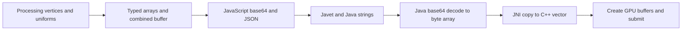

# Android graphics performance diagnostics — 2026-10-13

> Historical baseline. The renderer changes and follow-up measurements are in [Android graphics improvements](android-graphics-improvements.md).

Android graphics are slow because the shared drawing code generates many small draw operations and the Android adapter handles each one as a separate synchronous string transport, GPU resource allocation, render pass, and submission. The host also recreates the Vulkan swapchain on every presented frame. The problem affects the common renderer used by the examples.

On the connected **Samsung SM-A5360, Android 16**, Snake presented at **1.40 FPS**, with a **715 ms average interval** between presentations. This is a measured rendering problem. Touch handling was not identified as the primary issue in the user's report.

This investigation added diagnostics and reproducible measurement scripts. It did not change the renderer or application behavior.

**Physical-device evidence**

The phone's display is 1080 × 2400, with reported density 450. The phone was unlocked and Snake was visible during the recording. A nominal 10-second Perfetto recording contained 9.856 seconds of trace data. The installed Snake APK matched the local final APK byte-for-byte by SHA-256:

`54868cf5e2d751f99cbc7a1215dc1f58b0095cdeb16016033f74dae0fe51cdb3`

The APK's bootstrap, Android GPU adapter, and Processing module also matched the source used by the local benchmark. Its Wasm host did not contain the earlier diagnostic `CALL` logging.

| Snake measurement | Result |
|---|---:|
| Vulkan presentation calls | 14 |
| Consecutive presentation intervals | 13 |
| Presentation cadence | 1.399 FPS |
| Mean / median interval | 714.9 / 737.9 ms |
| Minimum / nearest-rank p95 interval | 647.5 / 763.9 ms |
| Vulkan `QueueSubmit` calls | 6,814 |
| Total time inside traced `QueueSubmit` calls | 710.7 ms |
| `CreateSwapchainKHR` calls | 14 |
| Average time inside `CreateSwapchainKHR` | 16.06 ms |
| `Aquarius-Wasm` CPU time | 6,991 ms; 70.9% of one core |
| `mali-cmar-backe` driver-thread CPU time | 2,849 ms; 28.9% of one core |

There were approximately **487 queue submissions per presentation** in this window. This ratio includes recording boundaries and driver submissions; it is not an exact count of Aquarius drawing API calls per complete frame.

These are presentation-call intervals, not input-to-display latency or GPU execution durations. CPU percentages measure scheduled CPU time, not GPU utilization. Nested trace slices must not be added together. The trace identifies substantial CPU/driver overhead, but it cannot assign the remaining runtime CPU time precisely among geometry, Wasm callbacks, Javet, string encoding, allocation, and wgpu without additional instrumentation or sampling.

A second 9.845-second recording covered Painter's launch and first redraw. It contained **1,169 queue submissions**, one Painter presentation, and one swapchain creation. Painter calls `noLoop` after drawing, so one presentation here is expected and must not be interpreted as a steady 0.1 FPS. Its installed APK also matched the local build (`24b84071fbc34c65fbfe9af0fee6a4596c1cdee6905df5417e639bda93d1014c`).

The device reported thermal status `1` after the recordings. Thermal status was not sampled throughout them, so the timings should be repeated under controlled device conditions when comparing a fix. Snake was restored to the foreground afterward. Only the temporary trace files created by this investigation were removed from the phone.

**1. Every small draw becomes a complete native render submission**

In [gpu.cpp](../AquariusAndroid/template/app/src/main/cpp/gpu.cpp), the `draw` branch at line 595 creates:

- Three buffers: vertices, 1,120-byte standard uniforms, and 1,024-byte user uniforms.
- Two bind groups and a sampled texture view.
- A command encoder and a render pass, plus color/depth attachment views.
- A separate queue submission, followed by resource releases.

The pass at line 309 stores color and depth every time and loads them again for subsequent draws. This repeats attachment and command setup for every line segment, label, fill, and image. The impact on GPU bandwidth needs a GPU capture; the repeated setup and submission are confirmed directly in the source and device trace.

The Android adapter's `Target.flush()` and device `flush()` are no-ops ([android-gpu.mjs](../AquariusAndroid/template/app/src/main/assets/aquarius/android-gpu.mjs), lines 20 and 41). There is no accumulated frame to flush. In comparison, [BrowserTarget](../AquariusWebCompiler/browser/wgpu.mjs) keeps an open pass across draws and submits it at `flush()`.

The common Processing implementation amplifies this cost. `polyline()` calls `segment()` once per edge, and each segment calls `draw()` ([processing.mjs](../AquariusCore/hosting/processing.mjs), lines 113–126). A normal filled, outlined rectangle creates five draws. A rounded one creates 37. The benchmark's outlined ellipse creates 65. This makes modest UI layouts expensive, without requiring complex shaders or a 3D scene.

The Snake trace spends about 51 ms in `QueueSubmit` per presentation when dividing the aggregate by 14. That alone exceeds a 60 Hz frame budget, before string transport, geometry, other native work, and presentation. This is an approximate aggregate, not an isolated complete-frame timing.

**2. Every draw sends its binary payload through base64 and JSON**

The transport is:



[android-gpu.mjs](../AquariusAndroid/template/app/src/main/assets/aquarius/android-gpu.mjs), line 3, encodes each payload and stringifies its descriptor. Its `draw()` at line 40 allocates vertex data and a combined buffer containing all vertices and both uniform blocks. [NativeBridge.gpu()](../AquariusAndroid/template/app/src/main/java/org/aquariuslang/android/NativeBridge.java), line 233, decodes the base64 into a Java byte array. [The JNI command entry](../AquariusAndroid/template/app/src/main/cpp/gpu.cpp), line 731, copies that array into a fresh vector and parses the JSON.

For a six-vertex quad, the payload is **2,432 binary bytes**, of which **2,144 bytes are uniforms**. It becomes **3,244 base64 characters**, plus JSON. The uniforms are retransmitted even when most values are unchanged. `bootstrap.js` builds the base64 string with one temporary string per three input bytes and then joins the array.

The reproducible local benchmark uses the actual Processing implementation, Android GPU adapter, and bootstrap encoders. The native call is replaced with a counting stub. It measures geometry, JS packing, base64 encoding, and JSON transport on Windows / Node v24.18.0 / Intel i9-13900H, with three warmups and the median of nine samples. It excludes Aquarius/Wasm callbacks, Java/Javet/JNI, native decoding, Vulkan, GPU work, display, and Android scheduling.

| Synthetic frame | Draws | Binary payload | Host JS median | Derived native submissions before presentation |
|---|---:|---:|---:|---:|
| 100 filled rectangles | 100 | 237.5 KiB | 2.96 ms | 101 |
| 100 outlined rectangles | 500 | 1,187.5 KiB | 14.45 ms | 501 |
| 20 outlined rounded rectangles | 740 | 1,847.5 KiB | 23.12 ms | 741 |
| 20 outlined ellipses | 1,300 | 3,256.3 KiB | 38.96 ms | 1,301 |
| 12 filled spheres, detail 28 × 18 | 12 | 1,726.1 KiB | 48.58 ms | 13 |

Each frame includes one background clear. Native submission counts are derived from the current C++ implementation; the benchmark does not execute a GPU. The 20 outlined ellipses imply **3,900 buffer creations and 2,600 bind-group creations** per redraw under that implementation.

For a 640 × 480 RGBA payload, the production JavaScript base64 encoder alone took **18.48 ms** and the decoder **15.13 ms** on this PC. A Node-native encoding reference took 0.38 ms; this comparison illustrates string-processing cost, not a measured Android fix or a Node API available inside Javet. The desktop scene timings must not be presented as phone frame timings or added to the device measurements.

**3. Presentation recreates the swapchain every frame**

`present()` caches the surface object when `surfaceGeneration` changes, but calls `wgpuSurfaceGetCapabilities()` and **`wgpuSurfaceConfigure()` unconditionally** at [gpu.cpp](../AquariusAndroid/template/app/src/main/cpp/gpu.cpp), lines 352 and 373. The trace confirms 14 swapchain creations for 14 presentations, with repeated buffer allocations and dequeues.

wgpu 29 documents that reconfiguring an existing surface waits for GPU idle and recreates its swapchain. Cache configuration and change it only when the surface, device, extent, or relevant format changes, or when acquisition requires recovery. [wgpu 29 Surface documentation](https://docs.rs/wgpu/29.0.1/wgpu/struct.Surface.html#method.configure).

This is a clear, localized first fix, but **16 ms of swapchain creation cannot explain a 715 ms frame interval by itself**. It must be addressed alongside submission and transport overhead.

**4. Frame pacing adds a full delay after work and lacks display synchronization**

Processing passes `frameStart` to `nextFrame()` ([processing.mjs](../AquariusCore/hosting/processing.mjs), line 22). Android's implementation ignores it, always sleeps approximately `1000/fps`, and then calls `waitFrame(1)` ([android-host.mjs](../AquariusAndroid/template/app/src/main/assets/aquarius/android-host.mjs), line 60). The Java actor also polls timers and sleeps 1 ms ([NativeRuntime.java](../AquariusAndroid/template/app/src/main/java/org/aquariuslang/android/NativeRuntime.java), lines 70–74).

At a requested 60 FPS, the frame interval includes the drawing time **plus roughly 17 ms of timer delay**, lifecycle waiting, and scheduling overhead. This cannot maintain 60 FPS when drawing already consumes a frame budget. It is secondary to the measured hundreds of milliseconds of work, but will remain visible after the larger bottlenecks are fixed.

Use a display-aware frame signal and elapsed-time accounting, with bounded frames in flight. Android's frame-pacing guidance describes Choreographer and the Frame Pacing library for OpenGL/Vulkan; direct Swappy integration needs backend support for the underlying presentation calls. [Android Frame Pacing guidance](https://developer.android.com/games/sdk/frame-pacing/).

**Additional costs and exclusions**

Spheres regenerate their tessellation and flatten/repack all vertices on each call. Retained shapes also regenerate their draw vertices; they do not retain a GPU mesh ([processing.mjs](../AquariusCore/hosting/processing.mjs), lines 111, 135, 137). This is particularly relevant to Marble/PBR, although those apps were not profiled on this phone in this investigation.

Full physical-resolution render targets and the fullscreen presentation pass add work. The default Android adapter uses the physical display dimensions. A resolution sweep can quantify that cost after submissions are reduced; lowering resolution will not remove thousands of CPU-side allocations or the base64 encoding of geometry.

Render pipelines are already cached per shader/depth/blend/mode in `gpu.cpp`; pipeline compilation on every draw is not what the current code does. Text rasterization has a 256-entry cache. Changing labels may still generate texture traffic, but static labels do not inherently rerasterize every frame.

The default prepared JNI library is compiled with `-O2` by [prepare-android.ps1](../scripts/prepare-android.ps1). Direct APK output uses `assembleDebug`, but changing that to release will not remove the transport, submissions, or swapchain recreation. A release baseline is useful after structural changes.

The target uses native V8 and Vulkan, with no WebView. ONNX CPU inference, camera conversion, and audio are additional workload-specific costs; they do not explain Snake's renderer measurements. The earlier [performance review](archive/performance-review.md) concerns a retired VM and must not be used to attribute this regression to old interpreter behavior.

**Fix order and validation**

| Order | Change | Evidence / success criterion |
|---|---|---|
| 1 | Cache surface configuration | Zero steady-state `CreateSwapchainKHR` calls after warmup at unchanged size; reconfigure correctly on rotation, resize, resume, and acquisition recovery. |
| 2 | Accumulate draws into passes and submissions; combine stroke segment geometry | Submission count scales with target/dependency transitions rather than primitive count. Preserve draw order, clipping, blending, offscreen dependencies, clear semantics, and readback boundaries. |
| 3 | Replace per-draw base64 with a binary transport and reusable vertex/uniform storage | No GPU payload base64 in steady drawing; use a supported typed-array/byte-buffer bridge, with explicit ownership and resource lifetimes. Bound memory while GPU work is in flight. |
| 4 | Reuse immutable GPU geometry and bind groups where state permits | Repeated spheres/retained shapes avoid tessellation and vertex uploads; mutable shapes invalidate correctly. Avoid rewriting buffers still referenced by pending submissions. |
| 5 | Correct frame deadlines and synchronize presentation | Measure presentation cadence and p95 intervals after CPU costs fall; avoid drawing-time-plus-full-period pacing. |

Changing surface configuration is the smallest confirmed repair. Batching, stroke geometry, and binary transport address the broader cause of extremely low throughput. Do not promise 60 FPS from one edit: the uninstrumented runtime CPU share still needs measurement after each structural change.

Repeat the same Snake scene under consistent thermal conditions. Record at least 30 seconds after warmup for a follow-up comparison; the current 13 intervals establish severity but are a short baseline. Add instrumentation around frame construction, encoding, bridge execution, and native recording so their costs can be separated. Then measure Painter redraw completion and representative Marble/PBR scenes. Keep GPU readbacks out of normal frame loops and measure them separately when required.

Existing Android validation mostly runs one frame per original-project APK; the common Processing smoke case runs three. These checks can pass at 1 FPS. They need a separate sustained performance report. Because the apps render through `SurfaceView`/Vulkan, use Perfetto presentation and scheduling data rather than treating Android View/HWUI `gfxinfo` as the application's frame counter. [Android system-tracing guidance](https://developer.android.com/games/optimize).

**Reproduction and retained artifacts**

Run the local source benchmark without a device:

```powershell
node scripts/diagnose-android-graphics.mjs
```

Analyze a recorded trace with the provided script and an official Perfetto trace processor:

```powershell
node scripts/summarize-android-graphics-trace.mjs .android-build/graphics-diagnostics/snake.perfetto-trace
# Optional: pass a trace_processor executable path and output JSON path.
```

The analyzer queries `QueuePresentKHR`, `QueueSubmit`, `CreateSwapchainKHR`, scheduled thread CPU time, and thread states. It calculates median and nearest-rank p95 intervals, and preserves the raw presentation timestamps. The benchmark checks transport round trips and primitive draw counts, without machine-speed pass/fail thresholds.

The [portable evidence snapshot](android-graphics-diagnostics.json) preserves benchmark measurements, source hashes, device summaries, and APK verification. Larger local artifacts are retained under `.android-build/graphics-diagnostics`: `host-benchmark.json`, both `.perfetto-trace` files, both `*-summary.json` files, and both `*-trace.cfg` files. They are ignored build artifacts and are not required to read the report. The initial SurfaceFlinger latency query returned only zero timestamps and was not used to calculate FPS.

Trace collection used `android.surfaceflinger.frametimeline`, `linux.process_stats`, and ftrace `sched_switch`, `sched_wakeup`, CPU-frequency events, and `gfx`/`view` categories. The configs selected only the measured Aquarius package for app tracing. Perfetto v58.2 was downloaded from its official artifact manifest and verified with SHA-256 `adfa6bad3d72be3ba9b83fa2b17b69fa13b3ab1cad0f42e52b86188bd5f0f997`. [Official Perfetto tool manifest](https://get.perfetto.dev/trace_processor).
