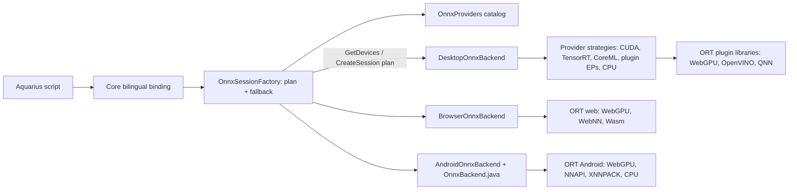

# ONNX Runtime

Aquarius exposes ONNX Runtime (ORT) through one bilingual library that selects the best
execution provider (EP) on every supported platform: CUDA and TensorRT on NVIDIA GPUs,
Core ML on Apple silicon, WebGPU on any GPU (native Dawn or the browser), WebNN in
browsers, NNAPI/XNNPACK on Android, optional OpenVINO/QNN plugins, and CPU everywhere.
Scripts are identical on all hosts; compiler lowering and applications never branch on
platform.

## Architecture

The design follows ORT's own layering:

* **Execution providers and EP devices.** ORT executes a graph through an ordered provider
  list; the graph partitioner assigns each node to the first provider that claims it and
  always keeps the CPU provider as the implicit final fallback. Since ORT 1.22 the unit of
  selection is an *EP device* (`OrtEpDevice`: a provider bound to a CPU, GPU or NPU), chosen
  by policies such as `PREFER_GPU`. Aquarius models exactly this.
* **Core (AquariusCore/onnx, contract version 2)** owns everything platform independent:
  * `OnnxProviders` — the single provider catalog (identity, bilingual constant, hardware
    classes). `OnnxProvider` is an extensible value (`"CUDA"`, `"WebGPU"`…), not a closed enum.
  * `OnnxDevice` — one provider on one hardware class with availability, an
    `Automatic` flag and a human-readable reason when unavailable.
  * `OnnxSelection` — a device preference (`Auto`, `GPU`, `NPU`) or an explicit, ordered
    provider list, parsed from either language.
  * `OnnxPlanner` / `OnnxSessionFactory` — ranking and fallback policy (below).
  * `OnnxTensor` snapshots, metadata, limits, failure kinds and the bilingual binding.
  * `OnnxProbeModel` — a 129-byte 1×1 convolution used by hosts to verify a provider
    really runs on this machine (driver, runtime libraries such as cuDNN, device, kernels).
* **Hosts implement only two members** (`IOnnxBackend` in C#, the same shape in JavaScript):
  `GetDevices()` — ranked best-first, unavailable entries kept with a reason — and
  `CreateSession(model, plan)` — strict: open exactly that provider chain or fail.
* The JavaScript mirror of the core lives in `AquariusCore/hosting/onnx-providers.mjs`
  (catalog, planner, `openSession`) and `onnx-registration.mjs` (binding, tensors); it is
  shipped unchanged to browsers and Android.



### Selection rules

* **Explicit providers are strict.** `"CUDA"` or `["TensorRT", "CUDA"]` must all be declared
  and available on this host, otherwise the call fails with the host's reason (for example
  `libcublasLt.so.13: cannot open shared object file`). A provider that fails to initialize
  never becomes a different session.
* **Preferences fall back.** `Auto` tries every available automatic device in host rank order
  and always ends with CPU. `GPU` / `NPU` try only devices of that class and never silently
  become CPU. A candidate is skipped only when it fails to initialize (engine/unsupported
  errors); invalid models, cancellation and closed runtimes stop immediately.
* **Automatic = false** marks devices used only on explicit request: TensorRT (first-run
  engine builds take seconds to minutes), software GPU adapters (llvmpipe, WARP, SwiftShader,
  browser fallback adapters) and WebGPU/NNAPI/XNNPACK on the Android emulator. ORT 1.30's
  XNNPACK model optimizer can abort the native process on emulator MediaPipe graphs even
  when the small probe passes; Auto uses CPU there, while real devices retain XNNPACK's rank.
* Sessions report `Backend/後端` (primary provider), `Device/裝置` (`CPU`/`GPU`/`NPU`) and
  `Providers/後端清單`, the effective chain including companions and the CPU fallback. ORT can
  still execute individual unsupported operators on CPU; the backend field does not claim
  every node ran on the accelerator.
* The MediaPipe pose tracker resolves the selection for its detector and opens the landmark
  model on the same chain, so both stages always share one device.

## Platform providers

CUDA-enabled executable packs embed the NVIDIA CUDA 13 runtime, cuBLAS, NVRTC,
cuDNN 9 and their license notices. Normal application builds need no download,
toolkit installation, Python, or custom packaging script. On Windows, source
hosts can also discover external NVIDIA runtime DLLs in
`onnx-providers/cuda/` beside the original executable (including single-file EXEs),
or in the absolute directories listed in `AQUARIUS_ONNX_CUDA_PATH`. Flat DLL folders,
CUDA toolkit `bin` / `bin/x86_64`, and NVIDIA Python package `cu13/bin/x86_64` plus
`cudnn/bin` layouts are supported; `CUDA_PATH` is also checked. These directories
are added only to the running process's PATH before the CUDA probe. Ship the
required CUDA 13, cuBLAS and cuDNN 9 DLLs with their NVIDIA license notices when
deploying a custom host instead of the standard self-contained executable pack.

Order is the `Auto` ranking. "Plugin" means an ORT plugin EP library registered at runtime
with `RegisterExecutionProviderLibrary`; optional plugins are discovered side by side.

| Platform | Ranked devices | Engine |
| --- | --- | --- |
| Windows x64 | CUDA³ (GPU) · OpenVINO GPU¹ · WebGPU (D3D12) · OpenVINO NPU¹ · TensorRT²³ · CPU | `Microsoft.ML.OnnxRuntime` 1.30.0 + WebGPU plugin 0.4.0; `…Gpu.Windows` with CUDA³ |
| Linux x64 | CUDA³ · OpenVINO GPU¹ · WebGPU (Vulkan) · OpenVINO NPU¹ · TensorRT²³ · CPU | `Microsoft.ML.OnnxRuntime` 1.30.0 + WebGPU plugin; `…Gpu.Linux` with CUDA³ |
| Windows arm64 | QNN NPU¹ (Snapdragon HTP) · WebGPU · CPU | `Microsoft.ML.OnnxRuntime` 1.30.0 + WebGPU plugin |
| Linux arm64 | WebGPU · CPU | `Microsoft.ML.OnnxRuntime` 1.30.0 + WebGPU plugin |
| macOS arm64 | Core ML NPU (Neural Engine + GPU) · Core ML GPU (Metal) · WebGPU (Metal) · CPU | `Microsoft.ML.OnnxRuntime` 1.30.0 (Core ML built in) + WebGPU plugin |
| Web | WebGPU · WebNN GPU · WebNN NPU · Wasm SIMD CPU | `onnxruntime-web` 1.30.0 (`ort.webgpu` bundle, local assets) |
| Android | WebGPU (Vulkan) · NNAPI · XNNPACK · CPU | `onnxruntime-android` 1.30.0 |

¹ Optional plugin, used when present. ² Explicit only. ³ Opt-in, see
[NVIDIA CUDA (opt-in)](#nvidia-cuda-opt-in); without it CUDA/TensorRT are listed as
unavailable with instructions.

### Tuning applied per provider

All sessions use `ORT_ENABLE_ALL` graph optimization, sequential execution and disabled
idle spinning so camera capture and drawing keep CPU time. Accelerated sessions run CPU
fallback nodes on one thread.

* **CUDA:** `arena_extend_strategy=kSameAsRequested`, exhaustive cuDNN convolution search,
  maximum cuDNN workspace, copies in the default stream. `AQUARIUS_ONNX_CUDA_DEVICE` selects
  the GPU index (default 0).
* **TensorRT:** FP16, persistent engine and timing caches under
  `%LOCALAPPDATA%/AquariusLang/onnx/tensorrt` (or `$AQUARIUS_ONNX_CACHE/tensorrt`); CUDA is
  appended as a companion for nodes TensorRT does not claim.
* **Core ML:** ML Program format; `MLComputeUnits=ALL` for the NPU device, `CPUAndGPU` for
  the GPU device; dynamic input shapes allowed.
* **WebGPU (desktop):** Dawn device from ORT's device discovery; independent of the
  graphics host's wgpu-native device, so native handles are never interchanged. Dawn
  state is process-wide, so WebGPU session creation, runs and disposal share one gate;
  CPU and CUDA sessions stay concurrent.
* **QNN:** HTP burst performance mode with FP16 precision for float models.
* **Browser:** `high-performance` WebGPU adapter; WebNN contexts request the matching
  `deviceType`; Wasm uses ORT's automatic multi-threading when the page is cross-origin
  isolated and one thread otherwise (no isolation requirement for deployments).
* **Android:** NNAPI with `CPU_DISABLED` (NNAPI's reference CPU path is slower than ORT's);
  XNNPACK owns the thread pool (`intra_op_num_threads`, ORT intra-op threads = 1); CPU uses
  half the cores up to four.

Data paths avoid redundant copies: desktop binds immutable input snapshots directly as ORT
values and copies each output once; browsers adopt ORT's downloaded output arrays;
Android binds direct native-order buffers and serializes outputs in bulk.

### NVIDIA CUDA (opt-in)

CUDA inference runtimes are large, so they are **not included by default**. The CUDA pack
contains ONNX's CUDA/TensorRT provider bridges plus pinned NVIDIA CUDA 13, cuBLAS, NVRTC,
cuDNN 9 and license notices. Without it CUDA and TensorRT are listed
as unavailable (with the steps below as the reason) and `Auto`/`GPU` use WebGPU instead. Enable
CUDA per project in `aqua.toml`, so every export of that project includes it without CLI flags:

```toml
[onnx]
cuda = true   # executable exports include ONNX CUDA and all CUDA inference runtime dependencies
```

| Where | How to opt in | Effect |
| --- | --- | --- |
| Project exports | `[onnx] cuda = true` in the root `aqua.toml` | `aqua build . --target windows\|linux -o …` uses the `build-targets/<rid>-cuda` runtime pack |
| One-off exports | `--onnx-cuda true` (overrides the manifest; `false` forces the standard pack) | same, for `.wasm`/source inputs or to override a project |
| Runtime packs | `scripts/publish-apphost.ps1 -OnnxCuda` / `bash scripts/publish-apphost.sh --onnx-cuda` | publishes `build-targets/win-x64-cuda` / `linux-x64-cuda` beside the standard pack |
| Compiler distribution | `scripts/publish-cli.ps1 -OnnxCuda`, `publish-cli.sh --onnx-cuda`, `build-release.bat -OnnxCuda` | ships both packs; `aqua run` itself can use CUDA |
| Source builds / tests | `-p:AquariusOnnxCuda=true` (or the `AquariusOnnxCuda=true` environment variable) | AquariusDesktop restores `Microsoft.ML.OnnxRuntime.Gpu.Windows/Linux` |

The setting only affects windows and linux executables (the RIDs with an ORT CUDA build);
web and Android exports of the same project ignore it, and `--onnx-cuda` is rejected for
them. Only the root project's `[onnx]` table applies; dependency manifests cannot add CUDA.
Each pack's `runtime.json` records `"onnxCuda"` and `"onnxCudaRuntime"`, and exports verify that the selected pack has
the requested flavour, so a missing or mismatched pack fails with the command that fixes it.
The CUDA build of ORT is a superset of the standard build: CPU and plugin EPs behave the same
and the CUDA/TensorRT libraries load only when requested.

For example, `aqua build . --target windows -o MyApp.exe` with the manifest above
produces one EXE containing the required NVIDIA inference libraries. Copying the
EXE to another PC is sufficient; .NET extracts its private libraries automatically.
The recipient supplies the compatible NVIDIA GPU and driver. CPU remains usable
without CUDA hardware. Older CUDA packs containing only ORT's provider bridge are
rejected instead of silently producing an EXE with missing dependencies.

Toolchain maintainers run `publish-apphost -OnnxCuda` (or `--onnx-cuda` on Linux).
It prepares SHA-256-pinned NVIDIA wheels from `scripts/cuda-runtime.lock.json`,
copies only runtime binaries and licenses, and embeds them in the runtime pack.
Python is needed only for this source publishing step; it is not used by normal
`aqua build` or deployed applications. Prepared payloads are verified and reused
offline. Windows source publishers can pass `-Python` or `-CudaRuntimeDirectory`.
`aqua run` in a CUDA-enabled compiler distribution carries the same libraries.
TensorRT's own SDK is an additional optional dependency; the CUDA setting does
not bundle the separate TensorRT SDK. The full CUDA compiler toolkit is unnecessary
for running ONNX inference.

### Desktop requirements and packaging

* **CUDA:** an NVIDIA GPU supported by CUDA 13 (Turing or newer) and a compatible driver.
  Standard CUDA-enabled executable packs include the runtime libraries privately.
  Custom source hosts can instead supply their own CUDA 13/cuBLAS/cuDNN 9 library
  paths. Unsupported hardware/drivers make CUDA unavailable; `Auto` continues with
  the next device, and explicit CUDA selection reports the initialization failure.
* **TensorRT:** TensorRT 10 libraries in addition to CUDA.
* CUDA and TensorRT are **opt-in** (below); every other provider ships by default.
* DirectML is deliberately not used: its ORT build is in sustained engineering, cannot coexist
  with the CUDA build in one process, and the WebGPU plugin covers AMD/Intel/Qualcomm GPUs
  through D3D12.
* **Optional plugins:** copy the native folder of `Intel.ML.OnnxRuntime.EP.OpenVINO`
  (`onnxruntime_providers_openvino_plugin.dll` / `.so` with its OpenVINO libraries) or
  `Qualcomm.ML.OnnxRuntime.QNN` (`onnxruntime_providers_qnn.dll` with the QNN libraries) next
  to the program, into an `onnx-providers` subfolder, or into a directory listed in
  `AQUARIUS_ONNX_PROVIDER_PATH`.
* Supported WebGPU plugin RIDs are win-x64, win-arm64, linux-x64, linux-arm64 and osx-arm64;
  Linux needs a Vulkan loader. Windows executable hosts embed a UTF-8 active-code-page
  manifest, avoiding the native plugin bridge's code-page conversion failure for Traditional
  Chinese deployment paths (Windows 10 version 1903 or later). Custom embedding hosts need the
  same manifest when native library paths contain Unicode characters.
* `AQUARIUS_ONNX_DIAGNOSTICS=1` prints the probed device table, selection attempts and native
  exception details on stderr.

Browser assets are packaged locally from pinned npm dependencies by `npm run prepare:browser`.
Core owns the deployment descriptor, runtime version, embedded assets and license notices.
Exports include hashes and need no CDN. WebGPU requires a compatible browser, driver and secure
context (HTTPS or localhost).

ONNX is a documented native integration under the host-capability profile: native hosts execute
ORT kernels in native providers, whereas browser kernels execute in ORT Wasm/WebGPU/WebNN. This
specific integration is an exception to the general future computational-library Wasm rule; it
must not be labelled `CoreWasm`. Portable demo preprocessing and postprocessing remain compiled
Aquarius Wasm. The profile does not grant a general exception to other computational libraries.

## Language API

Import `ONNX`, `ONNXRuntime` or `推論引擎`. Both names below reference the same
callable. Metadata fields and constants also have both spellings.

| Object | English / 繁體中文 | Arguments and result |
| --- | --- | --- |
| ONNX | IsSupported / 是否支援 | provider, preference or provider array → availability |
| ONNX | GetProviders / 取得後端清單 | → ranked device records |
| ONNX | CreateSession / 建立工作階段 | bundled model path [, provider, preference or provider array; default `Auto`] → session |
| ONNX | CreateTensor / 建立張量 | type, shape, flat values → tensor |
| Session | GetInputs / 取得輸入資訊 | → array of Name/名稱, Type/型別, Shape/形狀 records |
| Session | GetOutputs / 取得輸出資訊 | → same metadata |
| Session | Run / 推論 | input names, tensors, requested output names → ordered tensor array |
| Session | Dispose / 釋放 | → idempotent release |
| Tensor | GetType / 取得型別 | → type string |
| Tensor | GetShape / 取得形狀 | → dimension array |
| Tensor | GetData / 取得資料 | → independent flat array |

Device records have `Provider/後端`, `Device/裝置`, `Name/名稱`, `Available/可用`,
`Automatic/自動選用` and `Reason/原因`. Sessions have `Backend/後端`, `Device/裝置` and
`Providers/後端清單`; output tensors have `Name/名稱`.

Preference constants: `Auto/自動`, `GPU/圖形處理器`, `NPU/神經處理器`. Provider constants
(values are the English identifiers, matched case-insensitively):

| Provider | 繁體中文 | Hardware |
| --- | --- | --- |
| `CPU` | `中央處理器` | CPU |
| `CUDA` | `輝達CUDA` | NVIDIA GPU |
| `TensorRT` | `輝達TensorRT` | NVIDIA GPU |
| `CoreML` | `蘋果CoreML` | Apple Neural Engine / GPU |
| `WebGPU` | `網頁圖形加速` | any GPU |
| `WebNN` | `網頁神經網路` | browser GPU / NPU |
| `NNAPI` | `安卓神經網路` | Android NPU / DSP |
| `XNNPACK` | `行動處理器加速` | optimized mobile CPU |
| `OpenVINO` | `英特爾OpenVINO` | Intel GPU / NPU / CPU |
| `QNN` | `高通QNN` | Snapdragon NPU / GPU |

Type constants: `Float32/浮點32`, `Float64/浮點64`, `Int32/整數32`, `UInt8/無號整數8`,
`Bool/布林`. The tensor contract deliberately admits only those five types; int64, float16,
strings, sequences, maps and optional inputs require future contract extensions. Unsupported
metadata is visible as `unsupported` and cannot be supplied or materialized as a tensor.
Dynamic dimensions appear as -1.

```text
變數 引擎 = 匯入("推論引擎");
// 自動選擇此裝置最快的後端（例如 Windows 的 CUDA、Mac 的 CoreML、網頁的 WebGPU）
變數 工作 = 引擎.建立工作階段(目前工作目錄 + "/模型.onnx");
印出(工作.後端, 工作.裝置, 工作.後端清單);
// 只用圖形處理器；或依序指定後端清單
變數 加速 = 引擎.建立工作階段(目前工作目錄 + "/模型.onnx", 引擎.圖形處理器);
變數 指定 = 引擎.建立工作階段(目前工作目錄 + "/模型.onnx", [引擎.輝達TensorRT, 引擎.輝達CUDA]);
變數 資料 = 引擎.建立張量(引擎.浮點32, [2], [1, 2]);
變數 輸出 = 工作.推論(["input"], [資料], ["output"]);
印出(輸出[0].取得資料());
變數 清單 = 引擎.取得後端清單();
迴圈 (變數 i = 0; i < len(清單); i++) { 變數 項 = 清單[i]; 印出(項.後端, 項.裝置, 項.可用, 項.原因); }
工作.釋放();
```

Include models with CLI `--assets`; website source-directory builds also recognize
`.onnx`. Model external-data sidecars are not supported: use a single self-contained ONNX
file. Model input and output names are case-sensitive.

## Execution, ownership and extension rules

* All required inputs must appear exactly once, with matching type, rank and static
  dimensions. Requested outputs must be known, unique and nonempty. Ordering follows
  the request, independent of provider dictionary order.
* Tensors belong to their binding runtime. Keys use module scope identity so guest
  reprojection and garbage collection preserve ownership. Weak tables avoid rooting
  dead tensors; extracted methods retain their data. Engines read inputs in place but
  never write them; outputs are copied out of engine memory before upstream tensors are
  released, so disposed native results never invalidate existing tensors.
* Sessions own native resources until explicit release or host disposal. Maximum
  eight live sessions, sixteen tensor axes, 16,777,216 elements per tensor and
  256 MiB per model. GPU outputs are downloaded before releasing upstream tensors. Limits
  apply at the boundary; ORT's own internal allocations depend on model graph and device.
  Sessions cannot mix tensors from other binding runtimes.
* Native runs are serialized with disposal. Cancellation terminates native run options;
  native model creation can only observe cancellation before/after the synchronous engine
  call. Browser runs reject overlap. Browser cancellation is observed at async boundaries;
  upstream cannot forcibly abort an in-flight run. Disposal waits for the complete
  run/download/cleanup before releasing the session. Late session creation after
  cancellation/disposal releases its native resources.
* Device probing happens once per process (desktop and Android) or page (browser), on the
  first query, and is cached.

### Adding a provider

1. Add it once to the catalog in `OnnxProviders.cs` and `onnx-providers.mjs` (identity,
   bilingual constant, hardware classes); the language constants appear automatically.
2. Declare it on each host that supports it, at its rank: a `DesktopExecutionProvider`
   subclass (or a `PluginExecutionProvider` over a new `OrtPluginLibrary`) placed in
   `DesktopProviderCatalog`, a `Provider` entry in `OnnxBackend.java`, or an entry in
   `BrowserOnnxBackend.probe/executionProvider`. Put provider-specific options and session
   adjustments in that strategy; never in the core.
3. Add a parity test against CPU (`AQUARIUS_ONNX_REQUIRE=<provider>` runs the desktop
   checks on real hardware).

### Adding a platform

Implement `IOnnxBackend` (C#) or the `devices()/createSession(model, plan, signal)` pair
(JavaScript) and register the language surface with `OnnxRuntime` or `registerOnnx`.
Selection, fallback, validation, the bilingual surface and the pose pipeline then work
unchanged. GPU buffer interoperability (IO binding of device tensors), external model data
and additional element types need explicit ownership/version designs before extending this
CPU-snapshot contract.

## MediaPipe pose pipeline

`MediaPipe` / `姿態追蹤` is a separate, model-specific library composed over the
generic ONNX contract. `CreatePoseTracker` / `建立姿態追蹤器` takes the detector
path, landmark path and an optional provider, preference or provider array (default `Auto`);
the tracker exposes the selected `Backend/後端`. A tracker owns both
sessions and one isolated 16 MiB Wasm instance; at most four trackers per runtime.
`Analyze` / `分析` takes an application image handle and a nonnegative, monotonic
timestamp in milliseconds since capture started. Input limits are 1920 × 1080.
`Reset` / `重設` discards tracking and smoothing state; `Dispose` / `釋放` is
idempotent. Calls on a disposed tracker fail. One tracker processes one frame at
a time. Images and tensors remain runtime-owned; no scalar pixel arrays cross
the language boundary.

Result fields have English/Traditional Chinese aliases: `HasPose` / `有人物`,
`Confidence` / `信心`, `Landmarks` / `關鍵點`, `TotalMilliseconds` / `總耗時`,
`InferenceMilliseconds` / `模型耗時`, `DetectionRan` / `執行人物偵測`.
Landmarks are a flat 33 × 5 array: x, y, z, visibility, presence. x/y refer to the
original unmirrored frame, normalized by width/height; z uses frame width and
visibility/presence are sigmoid probabilities. Missing poses return an empty
array immediately, preventing stale skeletons. Display thresholds remain an
application decision; the example requires 0.75 and hides points outside the frame.

`AquariusCore/mediapipe/pose.c` is the sole implementation of letterboxing,
bilinear affine crops, 2254-anchor decoding, weighted suppression around the
strongest detection, 1.25 ROI expansion, heatmap refinement, inverse projection,
ROI tracking and adaptive One Euro filtering. Compile its committed `pose.wasm`
with `scripts/build-pose-wasm.ps1` (pinned Zig 0.15.1). C#/JavaScript adapters only
transfer bulk buffers and call the injected ONNX backend. Future hosts therefore
reuse this Wasm and implement the existing image, Wasm and ONNX contracts.
Single-person tracking periodically reacquires and reacquires after loss; it
does not associate identities across multiple people.

The contracts follow [MediaPipe postprocessing](https://github.com/google-ai-edge/mediapipe/blob/master/mediapipe/modules/pose_landmark/tensors_to_pose_landmarks_and_segmentation.pbtxt)
and [BlazePose ROI configuration](https://github.com/tensorflow/tfjs-models/blob/master/pose-detection/src/blazepose_tfjs/constants.ts).

## Validation

`dotnet test AquariusTests/AquariusTests.csproj --filter FullyQualifiedName~AquariusTests.Onnx`
tests real native CPU inference, the provider planner and fallback policy, device probing
(for example CUDA reported unavailable with the loader's message), bilingual Wasm binding,
metadata, shapes and lifetime. Set `AQUARIUS_ONNX_WEBGPU=1` to require native WebGPU
inference and `AQUARIUS_ONNX_REQUIRE=CUDA` (build with `-p:AquariusOnnxCuda=true`; or `TensorRT`, `CoreML`, `OpenVINO`, `QNN`,
or a comma-separated chain) to require real inference on that accelerator. Set
`AQUARIUS_ONNX_POSE_MODEL` to a MediaPipe model path to require real pose CPU/GPU
output comparison (absolute tolerance 0.05 plus relative 1%, for floating-point EP
differences). The tiny checked-in Add fixture is an ONNX IR 8/opset 13 model with
two float32 vectors; it contains no external model data.

`npm test --prefix AquariusWebCompiler` includes browser contract, device ranking,
preference fallback, cancellation, disposal and real Aquarius Wasm binding tests. `node AquariusWebCompiler/tests/onnx-browser.mjs`
checks a built MediaPipe project in Chromium: real CPU/WebGPU inference, nested
deployment URLs, numerical parity, camera preview and cleanup. See
[the Traditional Chinese demo](../examples/mediapipe/README.md).

Set `AQUARIUS_POSE_FIXTURES` to a directory containing upstream MediaPipe
`pose.jpg`, `pose_landmarks.pbtxt`, and the pinned `人物偵測.onnx` to enable real
person tests. They verify all 33 reference points (mean error <18 px), 90-degree
rotation, off-center framing, continuous ROI tracking, blank rejection and
CPU/WebGPU parity. `AQUARIUS_POSE_GUI=1` runs the actual desktop example with a
simulated camera, saves a screenshot and verifies shutdown and >20 fps. The
browser test optionally consumes `pose.y4m`, the native JSON results and a
`closeup.png` fixture to test real camera display and sustained frame rate.

Upstream references: [execution providers](https://onnxruntime.ai/docs/execution-providers/),
[EP device selection](https://onnxruntime.ai/docs/execution-providers/plugin-ep-libraries.html),
[CUDA EP](https://onnxruntime.ai/docs/execution-providers/CUDA-ExecutionProvider.html),
[Core ML EP](https://onnxruntime.ai/docs/execution-providers/CoreML-ExecutionProvider.html),
[native WebGPU EP](https://onnxruntime.ai/docs/execution-providers/WebGPU-ExecutionProvider.html),
[ORT WebGPU](https://onnxruntime.ai/docs/tutorials/web/ep-webgpu.html),
[session API](https://onnxruntime.ai/docs/api/js/interfaces/InferenceSession.html).
