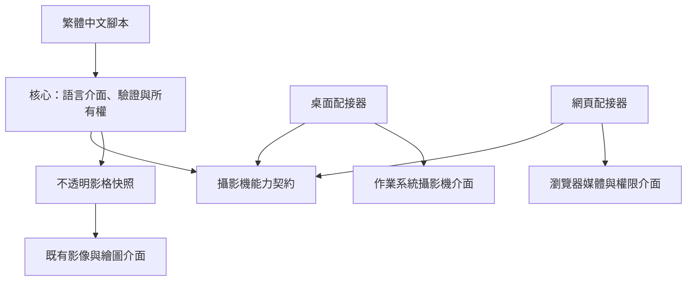

# 攝影機架構與使用指南

攝影機是宿主能力：核心定義契約、公開介面、資料格式與所有權，桌面及網頁目標負責存取裝置。匯入模組及查詢是否支援不會啟用攝影機。只有明確呼叫「開啟」才會取得裝置或請求權限；本功能不取得麥克風、不錄製影片，也不傳送影格。

## 分層與依賴方向



| 元件 | 責任 |
| --- | --- |
| `AquariusCore/webcam/IWebcamBackend.cs` | 裝置列舉、非同步開啟與擷取、取消、統一錯誤及不可變影格。 |
| `AquariusCore/webcam/WebcamRuntime.cs` | 公開名稱註冊、參數驗證、工作階段上限及資源釋放。 |
| `AquariusCore/webcam/WebcamCatalog.cs` | 共用函式目錄，讓編輯器、編譯器與網頁匯出取得相同介面。 |
| `AquariusDesktop/webcam` | 作業系統裝置列舉、擷取程序、最新影格接收、逾時與程序清理。 |
| `AquariusWebCompiler/browser/webcam.mjs` | 瀏覽器權限請求、影像軌道、畫布像素快照及取消清理。 |

核心不參考 FFmpeg、瀏覽器、作業系統擷取函式庫或圖形驅動套件。宿主透過建構子注入能力，測試可使用替身而不開啟實體攝影機。外部能力目錄以契約版本一登記此能力，不增加運算函式庫或可攜演算法；語言執行仍使用原有的 Wasm 執行流程。

桌面配接器使用 FFmpeg 作為原生裝置存取橋接，限定使用裝置輸入與原始 RGBA 輸出。擷取資料所需的格式及尺寸協調屬於宿主邊界；沒有提供任意媒體檔案、濾鏡、影像分析或通用編解碼介面。未來更換為直接呼叫原生裝置 API 時，只需替換配接器。

## 公開介面

```aquarius
變數 攝影機 = 匯入("攝影機");
變數 工作階段 = 攝影機.開啟("", 640, 480, 30);
變數 影格 = 工作階段.擷取影格();
印出(影格.寬度, 影格.高度, 影格.序號, 影格.時間戳記);
工作階段.釋放();
```

| 呼叫或欄位 | 行為 |
| --- | --- |
| `攝影機.是否支援()` | 查詢宿主是否具備擷取入口。不能保證裝置存在、權限已允許或指定模式可用。 |
| `攝影機.列出裝置()` | 傳回裝置陣列，每項具有「識別碼」及「名稱」。不主動要求網頁權限。 |
| `攝影機.開啟(識別碼, 寬度, 高度, 影格率)` | 開啟工作階段。空識別碼選取預設裝置；其他識別碼必須來自該宿主的列舉結果。 |
| `工作階段.是否開啟()` | 傳回工作階段是否仍可擷取。釋放後為假。 |
| `工作階段.擷取影格()` | 取得最新且尚未交付的完整影格，沒有新影格時才等待。慢速讀取會略過舊影格。桌面透過同步語言邊界等待，瀏覽器透過非同步宿主呼叫等待。 |
| `工作階段.釋放()` | 關閉裝置，重複呼叫安全。 |
| `影格.寬度`、`影格.高度` | 固定輸出尺寸，與開啟時指定的尺寸相同。 |
| `影格.序號` | 每個工作階段從一開始遞增。桌面以接收序號計算，略過舊影格時可跳號。 |
| `影格.時間戳記` | 自工作階段開始以來的單調時鐘毫秒數，表示取得快照的時間；不代表硬體曝光時間。 |
| `影格.影像` | 既有影像物件，可交給 `Window.轉為Processing圖片`、影像編碼等介面。 |
| `影格.取得像素()` | 傳回新的位元組陣列，順序為紅、綠、藍、不透明度。 |

公開攝影機名稱、欄位及功能錯誤均採繁體中文；既有模組名稱與工具識別碼維持專案原有規格。

寬度為一至一九二〇，高度為一至一〇八〇，影格率為一至六〇；全部必須是整數。每個執行環境最多同時開啟四個工作階段。預設操作逾時為十秒，宿主契約可設定一至六萬毫秒。影格是由上而下排列的不透明 RGBA8，長度恰為寬度乘高度乘四，每個不透明度位元組均為二五五。

影格保留獨立像素儲存，不借用原生記憶體或可變畫布；下一次擷取及工作階段釋放不會修改既有快照。序號及時間戳記只在同一工作階段內比較。不同平台的曝光、畫面內容及實際擷取速率取決於裝置，不要求像素完全相同。

兩個平台均以保留原始比例的縮放與黑色留邊產生指定尺寸，避免把寬螢幕影像拉成正方形。留邊屬於影格像素，影像分析及繪圖使用同一座標系統。

## 桌面部署

桌面使用 FFmpeg 的 DirectShow、Video4Linux2、AVFoundation 裝置輸入，分別對應 Windows、Linux、macOS。須安裝含對應裝置支援的 FFmpeg，放入搜尋路徑，或將 `AQUARIUS_FFMPEG` 設定為執行檔的完整路徑。`是否支援()` 只檢查平台與執行檔存在，實際裝置支援於列舉或開啟時確認。自包含的應用程式目前不自動附帶 FFmpeg，部署者須提供此依賴並遵守其散布授權。

裝置識別碼由配接器取得：Windows 優先使用裝置的替代識別碼，Linux 使用裝置節點，macOS 使用目前列舉索引。識別碼不應跨平台傳遞或永久儲存；重新連線及裝置順序改變後應重新列舉。Linux 的影像節點可能包含非擷取裝置，開啟時會明確回報無法使用。

所有參數透過程序參數清單傳遞，不使用命令殼層。程序只輸出完整原始影格，標準錯誤同步排空且診斷內容最多保留一六三八四字元。語言介面不顯示原生診斷或裝置路徑。背景接收器持續排空影格管線，以兩個固定尺寸的緩衝區交替接收與保留最新影格，繪圖速度不影響管線讀取。未交付的舊影格會被取代，因此暫停或慢速繪圖不會累積待播放畫面。只有完整影格才能發布，交付時複製為獨立快照；沒有新影格時才等待。輸出逐張清空並保留輸入影格節奏，不為補齊固定影格率而重複舊影格。

開啟時先取得首張影格，確認裝置可用後才傳回工作階段。裝置影格率不支援、裝置被占用、管線提早結束、取消或逾時，都會終止擷取程序。此適配器不保證每種攝影機都支援所要求的輸入影格率。

裝置介面的依據見 [FFmpeg 官方裝置文件](https://ffmpeg.org/ffmpeg-devices.html)。

輸出使用保留原始節奏的影格模式與逐包清空，設定依據見 [FFmpeg 命令文件](https://ffmpeg.org/ffmpeg.html) 和 [FFmpeg 格式文件](https://ffmpeg.org/ffmpeg-formats.html)。虛擬裝置測試以即時速度輸出，驗證慢速讀取仍取得新影格。

## 網頁部署與生命週期

網頁使用 `navigator.mediaDevices`，需要安全來源，例如 HTTPS 或瀏覽器認可的本機網址。權限尚未授予時，瀏覽器可能隱藏名稱、識別碼或部分裝置；空識別碼仍可直接請求預設攝影機。嵌入頁面還須由上層頁面允許攝影機權限。

開啟時只要求影像，不要求音訊；瀏覽器依偏好尺寸及影格率協調硬體模式，配接器將畫面投影至指定輸出尺寸。已解碼的新影格可立即擷取，只有影格尚未更新時才等待，避免推論之後再增加一個攝影機週期的延遲。影格等待優先使用瀏覽器影格通知，不支援時等待影像資料就緒。影像軌道拔除、操作逾時、執行取消及宿主釋放均停止所有軌道，移除事件與影格回呼，並解除影片來源。

瀏覽器的權限請求可能一直等待使用者，且無法直接撤銷。本實作對等待加入逾時與取消；若請求稍後才完成，立即停止新取得的軌道，防止取消後重新啟用攝影機。尚未完成的權限請求也計入工作階段上限。腳本完成或失敗時，宿主關閉該次執行仍持有的工作階段。

安全來源、權限及列舉限制的依據見 [瀏覽器擷取文件](https://developer.mozilla.org/en-US/docs/Web/API/MediaDevices/getUserMedia) 與 [裝置列舉文件](https://developer.mozilla.org/en-US/docs/Web/API/MediaDevices/enumerateDevices)。

## 錯誤與擴充規則

統一錯誤種類為「不支援」、「權限遭拒」、「找不到裝置」、「裝置無法使用」、「擷取逾時」、「已取消」、「已關閉」與「參數無效」。原生介面若無法準確區分權限或裝置失敗，回報「裝置無法使用」；瀏覽器不符合指定裝置條件時亦可能回報此種類。無效參數必須在存取裝置前攔截。

同一工作階段不可同時擷取多張影格。每次擷取失敗或取消後，該工作階段不再用於後續擷取，呼叫者可重新開啟。程式應在不再需要裝置時明確釋放；宿主釋放提供最後的清理保障。新增平台須實作相同契約，保持格式、上限、取消及所有權語意，並通過無硬體測試與平台冒煙測試。

## 測試

```powershell
./scripts/test-webcam.ps1
```

此命令執行核心與桌面單元測試、FFmpeg 虛擬裝置擷取、網頁單元測試、繁體中文腳本編譯封裝、桌面封裝執行，以及 Chrome 虛擬攝影機整合測試。需要 .NET SDK、Node.js、FFmpeg 及 Chrome；先在網頁編譯器目錄安裝既有 npm 依賴。可用 `-Dotnet` 指定 SDK 執行檔，`AQUARIUS_BROWSER` 指定 Playwright 瀏覽器通道。

測試入口支援 Windows PowerShell 5.1 與 PowerShell 7，含中文的腳本須保留 UTF-8 BOM，避免舊版 PowerShell 誤讀。未指定 `-Dotnet` 時，入口會檢查系統搜尋路徑與使用者目錄中的 SDK，避免誤用只有執行階段的 `dotnet`。

一般單元測試不接觸實體攝影機。桌面虛擬裝置測試只在 `AQUARIUS_WEBCAM_SMOKE=1` 時執行；測試腳本會設定並還原此變數。`-Hardware` 額外執行預設實體攝影機影格驗證，須由執行者明確選用。整批範例測試預設略過會開啟實體攝影機的兩支腳本，設為 `AQUARIUS_WEBCAM_HARDWARE=1` 才執行。

詳見 [繁體中文範例說明](../examples/webcam/README.md)。
